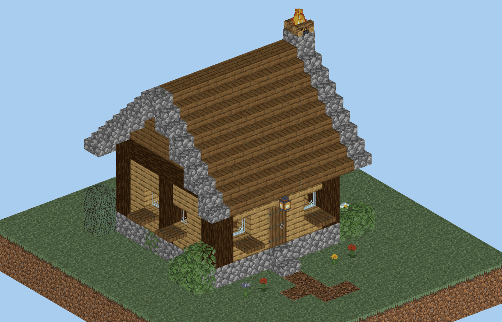
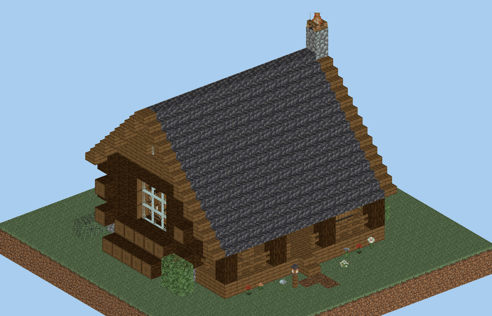
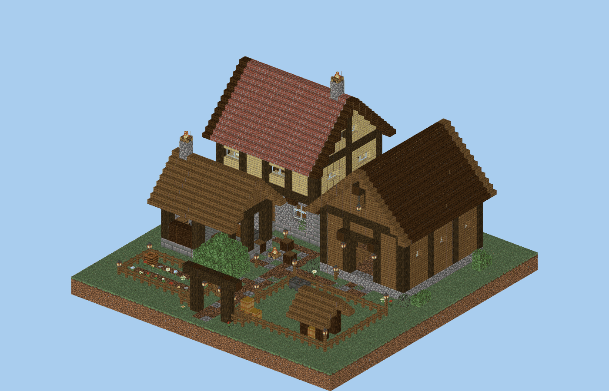
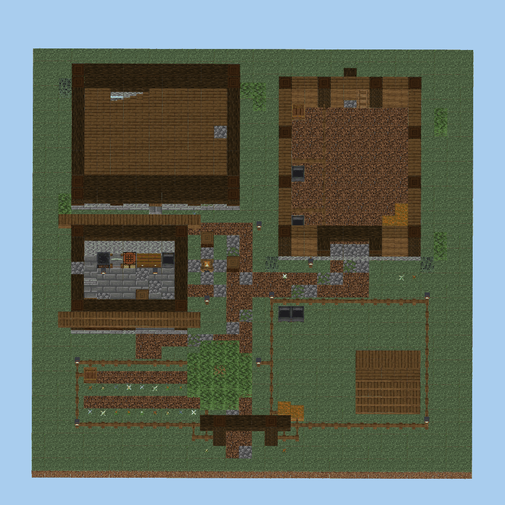

# Rustikale Basen für Bots – 3 Litematica-Vorlagen (Minecraft Java 26.3, Survival)

Drei Basen in unterschiedlicher Größe, gebaut für einen Bot, der sie im Survival selbst errichtet.
Zu jeder Basis gibt es

- die **Litematica-Datei** (`schematics/Basis_*.litematic`) und
- einen **Bauplan als JSON** (`bauplaene/*.json`): alle Blöcke in einer Reihenfolge, die ohne Gerüst
  funktioniert. Zu jedem Schritt steht, gegen welche Fläche geklickt wird, wohin der Bot schaut und welche
  Hälfte er trifft. Dazu kommt die Materialliste.

| | Basis | Größe (x × y × z) | Blöcke | Bauschritte | Eisen | Datei |
|---|---|---|---:|---:|---:|---|
| 1 | **Fichtenkate** (Starterhütte) | 12 × 12 × 13 | 307 | 305 | 4 | [`Basis_1_Starterhuette_Fichtenkate.litematic`](schematics/Basis_1_Starterhuette_Fichtenkate.litematic) |
| 2 | **Blockhaus mit Veranda** | 19 × 14 × 18 | 826 | 822 | 14 | [`Basis_2_Blockhaus_mit_Veranda.litematic`](schematics/Basis_2_Blockhaus_mit_Veranda.litematic) |
| 3 | **Gehöft** (2 × 2 Chunks) | 32 × 20 × 32 | 2 448 | 2 443 | 73 | [`Basis_3_Gehoeft.litematic`](schematics/Basis_3_Gehoeft.litematic) |

> **Stand: im Spiel getestet.** Alle drei Basen wurden auf einem echten 26.3-Server in genau der
> Reihenfolge des Bauplans gebaut. Danach lief ein Spieltag mit 100-facher Zufallstick-Rate, und jeder
> Block wurde aus den Regionsdateien zurückgelesen: **0 Abweichungen**. Die Dateien wurden zusätzlich mit der
> unabhängigen Bibliothek *litemapy* gelesen, ebenfalls ohne Abweichung. Details unter [Getestet](#getestet).

---

## 1. Die Basen

### Basis 1 – Fichtenkate (Starterhütte)



Kleine Hütte für den Anfang, 7 × 7. Sie braucht nur Fichte, Eiche und Bruchstein.

- Bruchsteinsockel, Fachwerk aus Fichtenstämmen, Wände aus Eichenbrettern, Fensterbänke aus Falltüren
- Satteldach aus Fichtentreppen mit einer Dachkante aus Bruchstein
- Kamin aus Bruchstein am Ostgiebel, oben brennt ein Lagerfeuer und raucht
- Innen: Bett, Werkbank, Ofen, Räucherofen, Doppelkiste, Fass, Teppich und eine Hängelaterne an der Kette

### Basis 2 – Blockhaus mit Veranda



Echtes Blockhaus, 13 × 9. Die Wände bestehen aus liegenden Fichtenstämmen. An den Ecken stehen die
Stämme abwechselnd über, wie bei einer verzapften Hütte.

- Schieferdach aus Bruchtiefenschiefer mit Dachkante aus Fichte. Die Südseite läuft als Schleppdach über die Veranda.
- Veranda mit Geländer, zwei Stühlen mit Tischchen, Fässern und Laternen
- Bruchsteinkamin am Ostgiebel, innen ein offener Kamin mit Lagerfeuer
- Innen: Wohnküche mit Esstisch und Kochecke, Vorratskammer mit 3 Kisten und Fässern, Dachboden mit
  2 Betten (Leiter an der Kammerwand)
- Holzstapel am Westgiebel, Laternenpfahl am Weg

### Basis 3 – Gehöft



Ein ganzer Hof auf genau 2 × 2 Chunks:



| Gebäude | Lage | Inhalt |
|---|---|---|
| **Bauernhaus** | x 2–14, z 3–11 | Erdgeschoss aus Bruchstein mit Ecksteinen. Darüber ein Obergeschoss in Fachwerk (Schwarzeiche + Birke), das nach Norden und Süden auskragt. Ziegeldach. Kamin durch den First. Küche, Stube mit Esstisch, Bücherregale, Treppe nach oben, 3 Betten. |
| **Scheune** | x 18–28, z 3–15 | Großes Tor im Südgiebel, Ladeluke mit Lastbalken und Laterne. Drinnen Boxen mit Zauntoren, Heu, Tränken, Heuboden mit Leiter. |
| **Werkstatt** | x 2–10, z 15–21 | Zum Hof hin offen. Esse mit Hochofen, Ofen und Räucherofen am Westgiebel, Schmiede- und Steinsägetisch, Kisten, Holzstapel. |
| **Weide** | x 17–29, z 19–29 | Zaun mit Tor, Laternen an den Ecken, Unterstand mit Heu, Tränken. |
| **Garten** | x 2–12, z 24–29 | Zaun, zwei Blumenbeete, Komposter, Laternen. |
| **Hof** | Mitte | Wege aus grober Erde mit Bruchstein, Feuerstelle mit Baumstumpf-Hockern, Hoftor mit Laternen, Hofbaum, Laternenpfähle. |

---

## 2. Bot-Regeln: Darauf sind die Vorlagen ausgelegt

Die Regeln werden beim Erzeugen automatisch geprüft (`basen/pruefung.py`).

| Regel | Warum |
|---|---|
| Nur Blöcke, die man im Survival **ohne Behutsamkeit** und **ohne Nether/End** bekommt | Der Bot kann alles selbst beschaffen. Laub braucht eine **Schere**. |
| Jeder Block mit **genau einem Rechtsklick** im Endzustand | Keine Doppelstufen, keine geöffneten Falltüren, keine Blumentöpfe mit Pflanze. Tür und Bett setzen ihre zweite Hälfte selbst. |
| **Keine Flüssigkeiten, keine Fallblöcke, nichts Wachsendes** | Kein Wasser oder Lava, kein Sand oder Kies, keine Felder und Setzlinge. Was der Bot baut, bleibt so. |
| **Jeder Block lässt sich in Reihenfolge setzen** | Für jeden Schritt gibt es eine Fläche zum Anklicken, und zwar so, dass Ausrichtung und Hälfte stimmen. Alle drei Basen kommen ohne Hilfsblöcke aus. |
| **Halt für Anbauteile** | Laternen, Leitern, Türen, Teppiche und Blumen haben ihren Halt, bevor sie gesetzt werden. |
| **Kein dunkler Spawnplatz** | Unter jedem Dach und auf jeder gebauten Fläche ist das Blocklicht mindestens 1, dort spawnen nachts keine Monster. Auch das Gelände in der Basis ist fast überall beleuchtet (Starterhütte 65/69, Blockhaus 121/130, Gehöft 322/327 Plätze). |
| **Zustände wie im Spiel** | Zäune, Glasscheiben, Treppenecken, Laub und Doppelkisten stehen in der Datei genau so, wie das Spiel sie beim Bauen selbst setzt. Litematicas Verifier zeigt deshalb nach dem Bauen alles grün. |

---

## 3. Einsetzen

### Mit Litematica (Spieler oder Bot, der die Platzierung liest)

1. Litematica + MaLiLib für 26.3 installieren, die `.litematic` nach `.minecraft/schematics/` kopieren.
2. `M` → *Load Schematics* → Datei wählen → *Load*.
3. **Ebene 0 ist die Geländeoberfläche.** Die Platzierung so legen, dass Ebene 0 die oberste Gras- bzw.
   Erdschicht ersetzt. Was auf Ebene 0 steht (Wege, Sockelsteine, Feuerstelle), ersetzt das Gras.
   **Luft auf Ebene 0 heißt: Gelände bleibt, wie es ist.** Der Verifier listet dieses Gras auf Ebene 0 als
   „Extra“. Das darf man ignorieren.
4. Den Bauplatz vorher ebnen. Ab Ebene 1 muss alles frei sein, was nicht in der Vorlage steht (Gras, Blumen, Bäume).
5. Das Gehöft liegt genau in 2 × 2 Chunks, wenn die Ecke an einer Chunkgrenze liegt (`F3 + G`).

### Mit dem Bauplan (`bauplaene/*.json`)

Der Bauplan ist für einen eigenen Bot gedacht, der Schritt für Schritt baut. Koordinaten sind relativ zur
Schematic-Ecke: x = Osten, y = oben, z = Süden. Kopf der Datei:

```json
{
 "name": "blockhaus", "titel": "Blockhaus mit Veranda", "minecraft": "26.3",
 "groesse": [19, 14, 18], "boden_y": 0,
 "regeln": ["..."],
 "material": [{"item": "minecraft:spruce_log", "name": "Fichtenstamm", "anzahl": 213, "stapel": "3 St. + 21"}, "..."],
 "schritte": [ ... ]
}
```

Typische Schritte:

```json
{"nr":1,"aktion":"setzen","pos":[8,0,16],"block":"minecraft:coarse_dirt","zustand":{},"item":"minecraft:coarse_dirt",
 "klick":{"block":[8,-1,16],"seite":"up","gelaende":true},"extra":["vorher den Geländeblock an dieser Stelle abbauen"]}
{"nr":102,"aktion":"setzen","pos":[4,2,1],"block":"minecraft:spruce_trapdoor","zustand":{"facing":"north","half":"top",...},
 "item":"minecraft:spruce_trapdoor","klick":{"block":[4,2,2],"seite":"north"},"treffer":"oben"}
{"nr":139,"aktion":"setzen","pos":[5,2,8],"block":"minecraft:spruce_door","zustand":{"facing":"north","half":"lower","hinge":"left",...},
 "item":"minecraft:spruce_door","klick":{"block":[5,1,8],"seite":"up"},"blick":"north",
 "extra":["Oberseite in der Hälfte Richtung west anklicken (Scharnier left)"],"fuellt_auch":[[5,3,8]]}
```

| Feld | Bedeutung |
|---|---|
| `aktion` | `setzen`; nur bei Bedarf `hilfsblock` (Erde setzen) und `abbauen` (gleich danach wieder weg). Die drei Basen brauchen keine Hilfsblöcke. |
| `pos`, `block`, `zustand` | Zielposition und vollständiger Blockzustand (wie in der `.litematic`) |
| `item` | Gegenstand, der dafür in die Hand muss (z. B. Wandfackel → `torch`) |
| `klick.block`, `klick.seite` | Diesen Block an dieser Fläche anklicken (`up` = Oberseite, `north` = Nordseite …). `gelaende: true` heißt natürlicher Boden. |
| `blick` | Blickrichtung beim Setzen: Treppen, Türen, Betten, Zauntore, Lagerfeuer schauen wie der Bot; Öfen, Kisten, Lesepult, Steinsäge schauen zum Bot. `oben`/`unten`: steil nach oben/unten schauen (Hängelaterne, Fass nach oben). |
| `treffer` | `oben`/`unten`: obere oder untere Hälfte der angeklickten Seitenfläche treffen (Treppen, Stufen, Falltüren) |
| `extra` | Zusatzhinweise: Klickhälfte für das Türscharnier, Schleichen bei Kisten, nach oben schauen, Gelände vorher abbauen |
| `fuellt_auch` | Diese Positionen füllt das Spiel beim selben Klick (obere Türhälfte, Kopfende des Betts). Sie müssen frei sein. |

Die Reihenfolge baut Ebene für Ebene von unten nach oben, in jeder Ebene erst die tragenden Blöcke, dann
Möbel und Anbauteile. Hängelaternen kommen, sobald der Block darüber steht, Türen erst, wenn ihre Nachbarn
stehen (das Scharnier hängt davon ab).

---

## 4. Material (Hauptposten)

Die vollständige Liste steht im Bauplan unter `material`. Gezählt sind Gegenstände; Türen und Betten je einmal.

| Basis 1 – Fichtenkate | | Basis 2 – Blockhaus | | Basis 3 – Gehöft | |
|---|---:|---|---:|---|---:|
| Fichtenholztreppe | 56 | Fichtenstamm | 213 | Fichtenholzbretter | 419 |
| Eichenholzbretter | 46 | Bruchtiefenschiefertreppe | 156 | Schwarzeichenstamm | 377 |
| Fichtenstamm | 42 | Fichtenholzbretter | 131 | Bruchstein | 256 |
| Fichtenholzbretter | 42 | Eichenholzbretter | 77 | Schwarzeichenholztreppe | 188 |
| Bruchstein | 36 | Bruchstein | 59 | Grobe Erde | 175 |
| Bruchsteintreppe | 19 | Glasscheibe | 32 | Ziegeltreppe | 156 |
| Brauner Teppich | 9 | Fichtenholztreppe | 30 | Fichtenholztreppe | 142 |
| Glasscheibe | 7 | Fichtenholzzaun | 23 | Birkenholzbretter | 118 |
| Fichtenholzstufe | 7 | Bruchtiefenschieferstufe | 13 | Fichtenholzzaun | 114 |
| Laterne | 2 | Laterne | 7 | Steinziegel | 113 |
| **Eisen** | **≈ 4** | **Eisen** | **≈ 14** | **Eisen** | **≈ 73** |
| Laub (Schere) | 8 | Laub (Schere) | 14 | Laub (Schere) | 74 |

Eisen steckt vor allem in Laternen (8 Nuggets), Ketten, Kesseln, dem Hochofen, Schmiedetisch und Steinsäge.

---

## Getestet

**Statisch** (`python3 build_basen.py`, bricht bei jedem Fehler ab):

- Jeder Blockzustand existiert in 26.3 (Blockliste aus dem Datengenerator des 26.3-Servers).
- Bot-Regeln aus Abschnitt 2, Halt für Anbauteile, Lichtprüfung (Blocklicht ab allen Laternen und Lagerfeuern;
  Treppen und Stufen zählen dabei vorsichtshalber als lichtdicht).
- Bauplan: Jeder Block hat zum Zeitpunkt seines Schritts eine passende Fläche zum Anklicken. Türscharniere und
  Doppelkisten kommen beim Setzen so heraus wie geplant.
- Die geschriebene Datei wird mit einem eigenen Decoder zurückgelesen und mit dem Modell verglichen.

**Im Spiel** (`tests/ingame/basen_test.py`, headless 26.3-Server, Flachwelt):

| Prüfpunkt | Fichtenkate | Blockhaus | Gehöft |
|---|---|---|---|
| Schritte per `/setblock` in Bauplan-Reihenfolge, alle mit Wirkung | ✅ 305 | ✅ 822 | ✅ 2 443 |
| 1 Spieltag mit 100-facher Zufallstick-Rate (Laub, Pflanzen, Feuer hätten Zeit sich zu ändern) | ✅ | ✅ | ✅ |
| Zurückgelesen aus den Regionsdateien: Abweichungen zum Modell | ✅ 0 | ✅ 0 | ✅ 0 |
| Datei unabhängig mit *litemapy* gelesen: Abweichungen | ✅ 0 | ✅ 0 | ✅ 0 |

Das Spiel berechnet beim Bauen Zaun-, Scheiben-, Mauer- und Treppenzustände selbst aus den Nachbarn. Dass
nach dem Bauen alles mit der Datei übereinstimmt, zeigt: Die Datei enthält genau die Zustände, die beim
echten Bauen entstehen. Der Test hat dabei zwei Fehler gefunden, die vorher nicht auffielen (Zäune verbinden
sich mit Kompostern, ein Kehlbalken ragte durchs Dach). Beide sind behoben.

## Grenzen

- **Klick-Hinweise:** Sie folgen den Platzierungsregeln aus dem Code von 26.3. Gesetzt wurden die Blöcke im
  Test aber per `/setblock`, nicht durch einen echten Client mit Rechtsklick. Ob dein Bot einen Schritt
  richtig ausführt, zeigt am Ende Litematicas Verifier.
- **Laufwege und Reichweite** des Bots plant der Bauplan nicht. Er sagt nur *was* in *welcher Reihenfolge*
  gesetzt wird, nicht *von wo aus*. Für Dächer braucht ein Bot ohne Fliegen eigene Gerüste oder Leitern.
- **Litematica-Mod selbst:** Der Import wurde nicht im Mod getestet. Das Dateiformat ist dasselbe wie bei
  den Farmen in diesem Repo und wurde mit *litemapy* gegengelesen.
- **Monster auf dem Gelände:** Innen und auf gebauten Flächen ist alles hell. Auf dem Gras am Rand der
  Basis bleiben ein paar dunkle Plätze (siehe Zahlen in Abschnitt 2).

---

## Für Bastler

```bash
python3 build_basen.py                 # alle Basen prüfen, .litematic + Bauplan schreiben, Material ausgeben
python3 build_basen.py blockhaus       # nur eine Basis
python3 tests/ingame/basen_test.py --server-dir <server>     # Ingame-Test (Server wie in der README beschrieben)
```

| Datei | Inhalt |
|---|---|
| `basen/starterhuette.py`, `basen/blockhaus.py`, `basen/gehoeft.py` | die drei Entwürfe als Code |
| `basen/kit.py` | Baukasten: Wände, Balkenkranz, Satteldach, Pultdach, Tür, Bett, Doppelkiste, Hängelaterne, Laternenpfahl, Büsche |
| `basen/katalog.py` | erlaubte Blöcke mit Form, Gegenstand, Licht, nötigem Werkzeug |
| `basen/zustaende.py` | Nachbarzustände wie im Spiel: Treppenecken, Zäune, Scheiben, Mauern, Zauntore, Laub-Abstand |
| `basen/bauplan.py` | Reihenfolge, Klick-Hinweise und, falls nötig, Hilfsblöcke; JSON-Ausgabe |
| `basen/pruefung.py` | statische Prüfungen (Bot-Regeln, Halt, Licht, Bauplan) |
| `basen/material.py` | Materialliste mit deutschen Namen (aus der 26.3-Sprachdatei) |
| `tools/vorschau/` | Vorschaubilder mit den Original-Blockmodellen und Texturen des 26.3-Clients |

**Vorschaubilder selbst rendern** (Node.js nötig; die Texturen gehören Mojang und werden deshalb lokal geladen):

```bash
python3 tools/vorschau/assets_holen.py            # einmalig: Blockmodelle + Texturen aus dem 26.3-Client
(cd tools/vorschau && npm install)                 # einmalig: three.js + Playwright (Chromium)
python3 tools/vorschau/vorschau.py gehoeft --ansicht sw --zoom 1.3 -o gehoeft.png
python3 tools/vorschau/vorschau.py blockhaus --ansicht top --schnitt 6   # Draufsicht, Dach abgeschnitten
```

**Eigene Basis bauen:** neues Modul unter `basen/` mit einer Funktion `build()`, die ein `kit.Bau` zurückgibt,
und einen Eintrag in `BASEN` in `build_basen.py`. Die Prüfungen sagen dann genau, welcher Block warum nicht
bot-tauglich ist.
